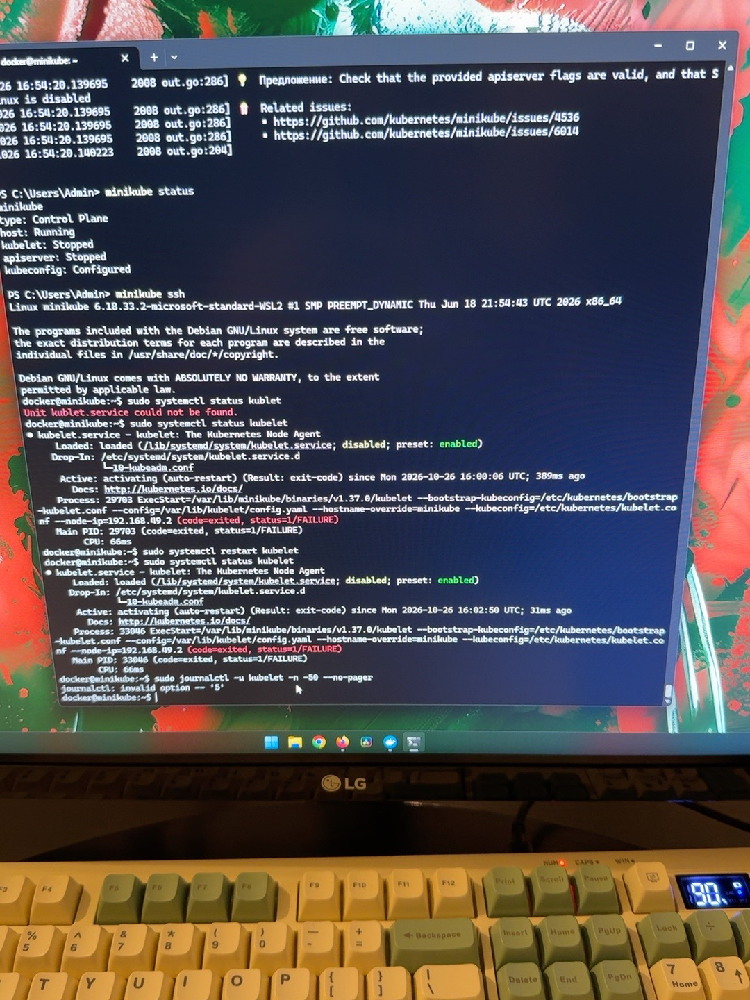
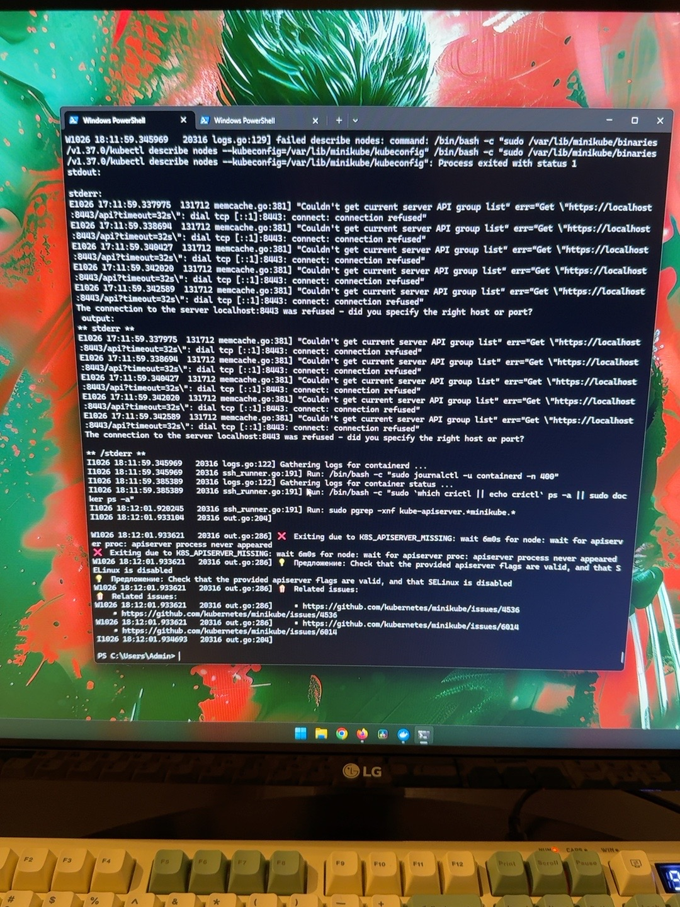
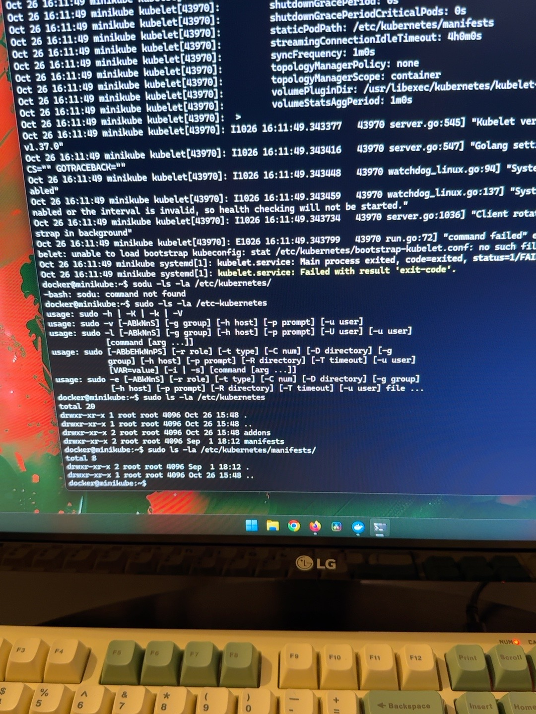

# Incident #001 — Kubernetes API Server Failure

## Incident Information

**Date:** October 26, 2026

**Environment:** Local Minikube Cluster

**Platform:** Windows / Docker Desktop

**Status:** Closed — Cluster Deleted

**Root Cause:** Not Confirmed

---

## 1. Incident Summary

During the startup of a local Kubernetes cluster
using Minikube, the Kubernetes API Server failed
to initialize.

Minikube reported the following error:

```text
K8S_APISERVER_MISSING
apiserver process never appeared
```


The issue prevented the Kubernetes Control Plane
from becoming operational.

---

## 2. Initial Investigation

The first diagnostic step was checking the status
of the Minikube cluster.

Command:

```bash
minikube status
```

Output:

```text
host: Running
kubelet: Stopped
apiserver: Stopped
kubeconfig: Configured
```

The Minikube container was running, but the
Kubernetes API Server and kubelet were stopped.

---

## 3. Kubelet Investigation

To investigate the kubelet service, I connected
to the Minikube node:

```bash
minikube ssh
```

Then checked the service status:

```bash
sudo systemctl status kubelet
```

The kubelet service repeatedly failed to start.

```text
Active: activating (auto-restart)
Result: exit-code
status=1/FAILURE
```

---

## 4. Log Analysis

I inspected the kubelet system logs:

```bash
sudo journalctl -u kubelet -n 50 --no-pager
```

The logs revealed an error related to
the kubelet bootstrap configuration:

```text
failed to load bootstrap kubeconfig
stat /etc/kubernetes/bootstrap-kubelet.conf:
no such file or directory
```


This indicated that the kubelet could not
locate the required configuration file.

---

## 5. Configuration Inspection

I inspected the Kubernetes configuration directory:

```bash
sudo ls -la /etc/kubernetes/
```

The expected kubelet configuration files
were not present.

Next, I inspected the static Pod manifest directory:

```bash
sudo ls -la /etc/kubernetes/manifests/
```

The directory was empty.

No Kubernetes Control Plane static Pod
manifests were found.



---

## 6. Findings

The investigation identified several issues:

- Kubernetes API Server was unavailable.
- Kubelet repeatedly failed to start.
- The kubelet bootstrap configuration was missing.
- Kubernetes static Pod manifests were absent.
- The Control Plane initialization was incomplete.

The underlying reason for the incomplete
initialization was not determined.

---

## 7. Recovery Action

The affected Minikube cluster was deleted:

```bash
minikube delete
```

This removed the local cluster.

A successful recovery has not yet been verified.

---

## 8. Lessons Learned

This incident provided practical experience with:

- Kubernetes Control Plane architecture
- Kubelet troubleshooting
- Linux systemd services
- Journal log analysis
- Kubernetes configuration files
- Static Pod manifests
- Incident documentation

The investigation also demonstrated the importance
of distinguishing symptoms from root causes.

---

## 9. Next Steps

- Initialize a new Minikube cluster.
- Verify API Server availability.
- Verify kubelet service status.
- Check Kubernetes system Pods.
- Document the recovery results.